# Avaliação 02 - Relatório de evidências

Estudante: Henrique Pereira Morais
Turma: 4 Semestre ADS  Data: 18/11/2026
Identificador AV02_ID:Henrique_Pereira_Morais  Porta utilizada: 8182

## E01 - Preparação / configuração válida
- Comandos executados: docker compose version - docker config --quiet - docker compose up -d --build - docker compose ps
- Saída relevante (retire qualquer senha real):
- Evidência anexada: E01_....png
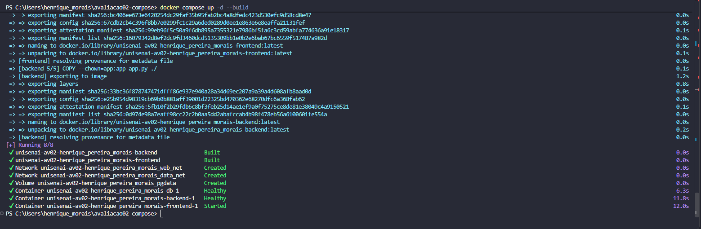
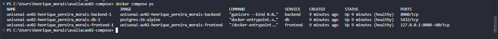


## E02 - Configuração segura do Compose
- Alterações no compose.yaml e .env.example:
- Como conferi que backend e db não publicam portas no host:
- Evidência anexada:
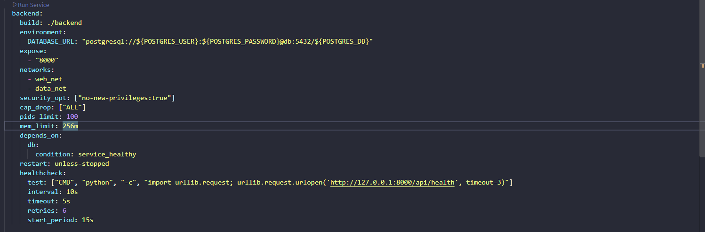
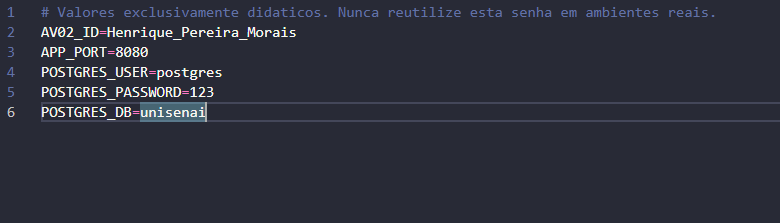
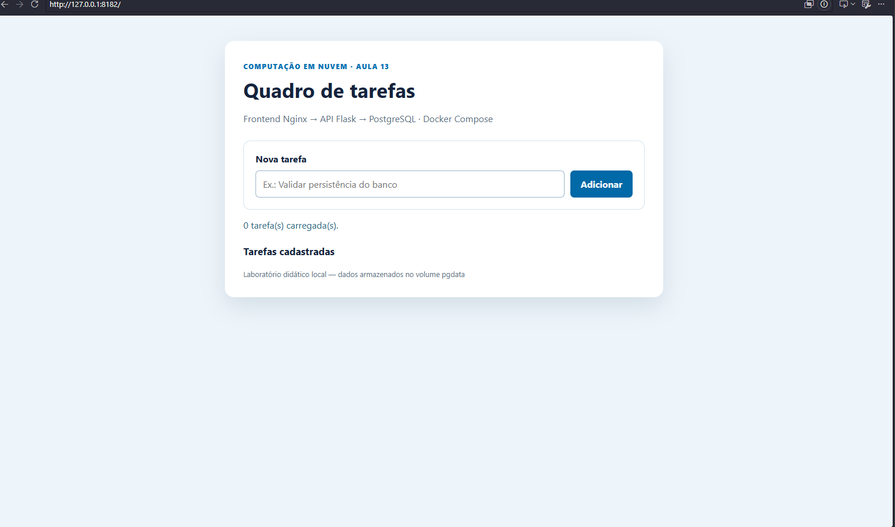

## E03 - Liveness, readiness e healthcheck
- Respostas HTTP normais observadas:
- Arquivos alterados:
- Evidência anexada:

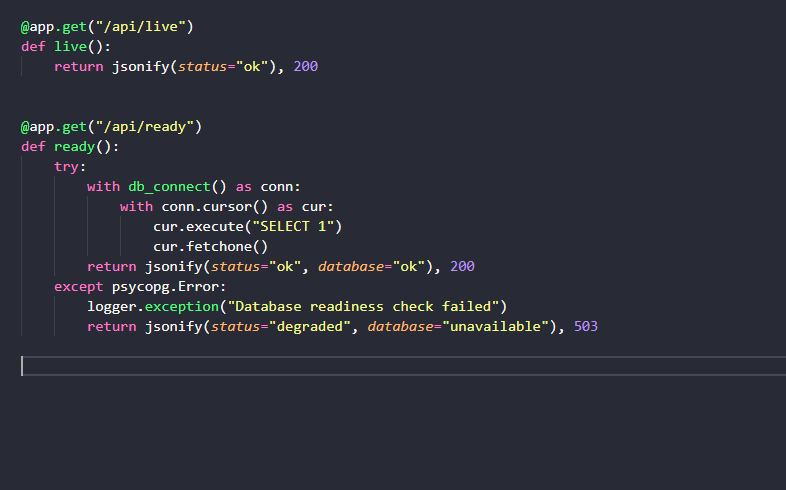
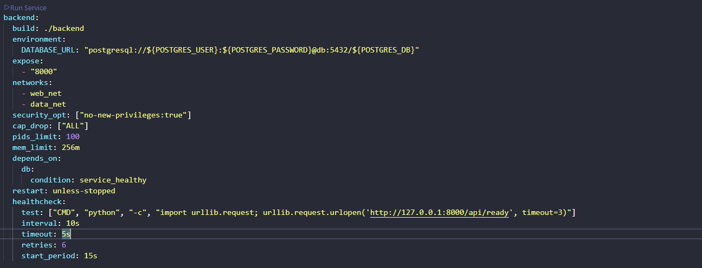
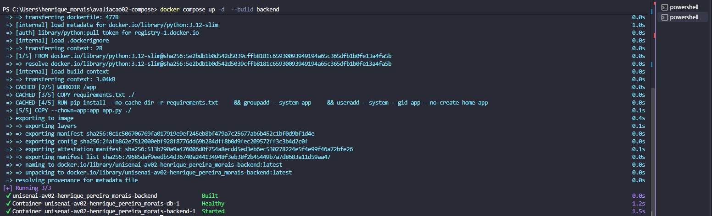
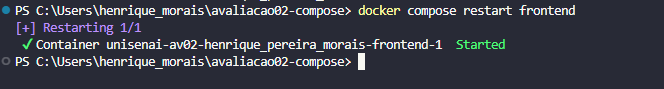
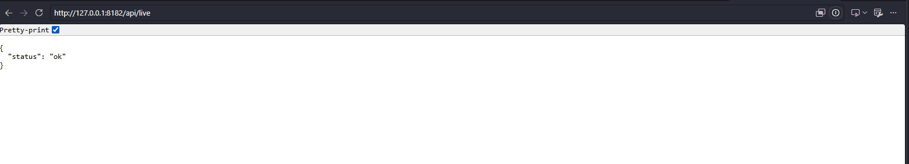
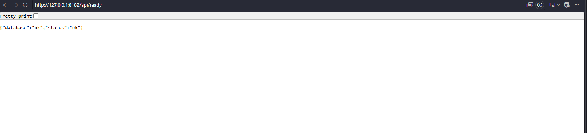

## E04 - Integração
- Título único da tarefa: AV02-<seu-ID>-integracao
- POST: código HTTP e trecho da resposta:
- GET ou tela da tarefa:
- Caminho da requisição browser > ... > banco:

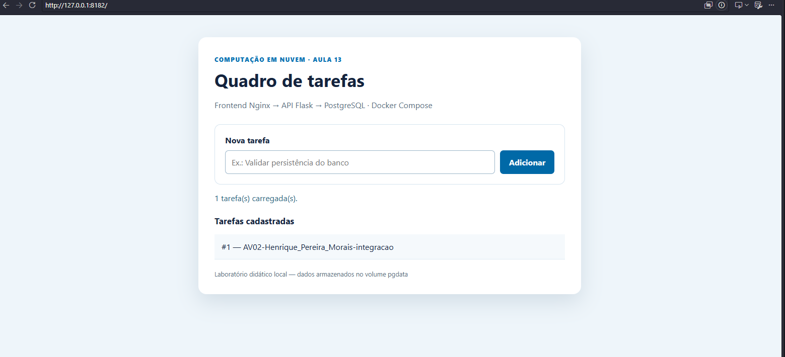

- Título único da tarefa: AV02-Henrique_Pereira_Morais-integracao
- POST: código HTTP e trecho da resposta:
  ```powershell
  Invoke-WebRequest -UseBasicParsing -Uri http://127.0.0.1:8182/api/tasks -Method Post -ContentType 'application/json' -Body '{"titulo":"AV02-Henrique_Pereira_Morais-integracao"}' | Select-Object StatusCode, Content

 Caminho da requisição browser > ... > banco:
  Navegador > porta 8182 do host (127.0.0.1) > frontend (Nginx, porta 80 do container) > proxy `/api/` > backend (Flask/gunicorn, `backend:8000`, rede `web_net`) > db (PostgreSQL, `db:5432`, rede `data_net`) > volume `pgdata`.

## E05 - Persistência
- ID/título antes do down:
- Comandos utilizados, sem -v:
- Evidência do mesmo registro após up:

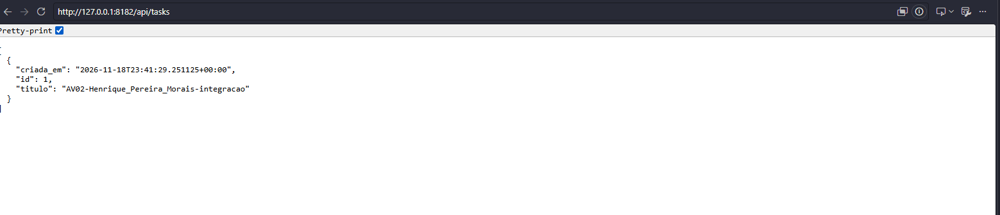
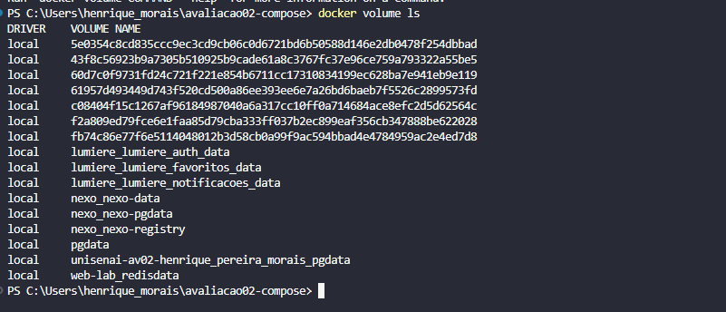
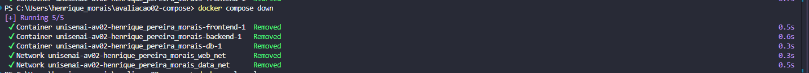

 Comandos utilizados, sem -v:
  ```powershell
  docker compose down
  docker volume ls
  docker compose up -d
  docker compose ps
  ```
  O `down` foi executado sem `-v`, então o volume `pgdata` foi mantido.
- Evidência do mesmo registro após up:
  ```powershell
  Invoke-RestMethod http://127.0.0.1:8182/api/tasks
  ```

## E06 - Falha controlada e recuperação
- Com db parado: /api/live = ___ e /api/ready = ___
- Qual log ou sinal investiguei:
- Após o start do db: /api/ready = ___
- Evidência anexada:

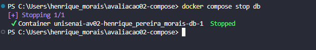
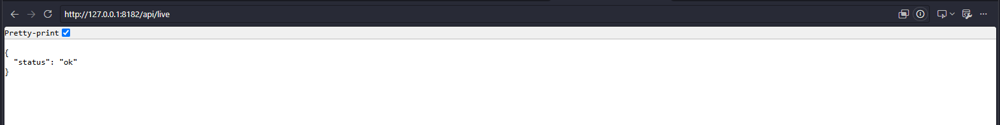
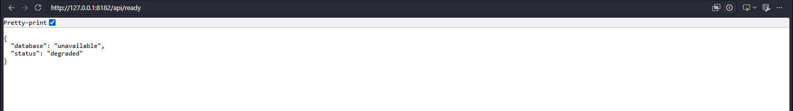
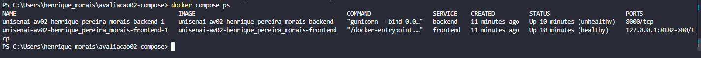
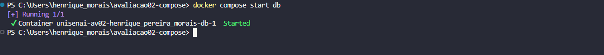
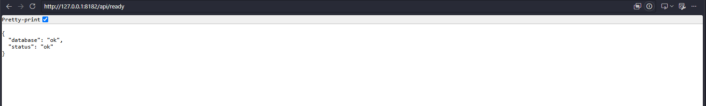

PS C:\Users\henrique_morais\avaliacao02-compose> docker compose logs --tail=40 backend
backend-1  |   File "/app/app.py", line 14, in db_connect
backend-1  |     return psycopg.connect(
backend-1  |            ^^^^^^^^^^^^^^^^
backend-1  |   File "/usr/local/lib/python3.12/site-packages/psycopg/connection.py", line 96, in connect
backend-1  |     attempts = conninfo_attempts(params)
backend-1  |                ^^^^^^^^^^^^^^^^^^^^^^^^^
backend-1  |   File "/usr/local/lib/python3.12/site-packages/psycopg/_conninfo_attempts.py", line 53, in conninfo_attempts
backend-1  |     raise e.OperationalError(str(last_exc))
backend-1  | psycopg.OperationalError: [Errno -2] Name or service not known
backend-1  | 127.0.0.1 - - [18/Nov/2026:23:59:48 +0000] "GET /api/ready HTTP/1.1" 503 47 "-" "Python-urllib/3.12"
backend-1  | Database readiness check failed
backend-1  | Traceback (most recent call last):
backend-1  |   File "/app/app.py", line 85, in ready
backend-1  |     with db_connect() as conn:
backend-1  |          ^^^^^^^^^^^^
backend-1  |   File "/app/app.py", line 14, in db_connect
backend-1  |     return psycopg.connect(
backend-1  |            ^^^^^^^^^^^^^^^^
backend-1  |   File "/usr/local/lib/python3.12/site-packages/psycopg/connection.py", line 96, in connect
backend-1  |     attempts = conninfo_attempts(params)
backend-1  |                ^^^^^^^^^^^^^^^^^^^^^^^^^
backend-1  |   File "/usr/local/lib/python3.12/site-packages/psycopg/_conninfo_attempts.py", line 53, in conninfo_attempts
backend-1  |     raise e.OperationalError(str(last_exc))
backend-1  | psycopg.OperationalError: [Errno -2] Name or service not known
backend-1  | 127.0.0.1 - - [18/Nov/2026:23:59:58 +0000] "GET /api/ready HTTP/1.1" 503 47 "-" "Python-urllib/3.12"
backend-1  | Database readiness check failed
backend-1  | Traceback (most recent call last):
backend-1  |   File "/app/app.py", line 85, in ready
backend-1  |     with db_connect() as conn:
backend-1  |          ^^^^^^^^^^^^
backend-1  |   File "/app/app.py", line 14, in db_connect
backend-1  |     return psycopg.connect(
backend-1  |            ^^^^^^^^^^^^^^^^
backend-1  |   File "/usr/local/lib/python3.12/site-packages/psycopg/connection.py", line 96, in connect
backend-1  |     attempts = conninfo_attempts(params)
backend-1  |                ^^^^^^^^^^^^^^^^^^^^^^^^^
backend-1  |   File "/usr/local/lib/python3.12/site-packages/psycopg/_conninfo_attempts.py", line 53, in conninfo_attempts
backend-1  |     raise e.OperationalError(str(last_exc))
backend-1  | psycopg.OperationalError: [Errno -2] Name or service not known
backend-1  | 127.0.0.1 - - [19/Nov/2026:00:00:09 +0000] "GET /api/ready HTTP/1.1" 503 47 "-" "Python-urllib/3.12"

## E07 - Justificativa técnica
1. Por que somente o frontend publica uma porta no host?
Resposta: O frontend é o único ponto de entrada: o navegador fala só com o Nginx, que encaminha `/api/` ao backend pela rede `web_net`. Publicar só essa porta reduz a superfície de ataque, porque a API e o banco não ficam acessíveis pelo host nem pela rede local. O backend usa `expose: 8000`, que apenas documenta a porta para outros containers, e o banco não declara porta nenhuma e fica na `data_net`, que é `internal` e só o backend alcança. A porta do frontend ainda é ligada a `127.0.0.1`, então só a própria máquina acessa.

2. Por que .env não deve ser tratado como cofre de segredos?
Resposta: O `.env` é um arquivo de texto puro, sem criptografia, controle de acesso, auditoria ou rotação de senhas. Os valores viram variáveis de ambiente dos containers e aparecem em `docker inspect` e na saída de `docker compose config`. Também podem vazar em logs, em um commit ou dentro de uma imagem, se o arquivo for copiado para ela. Por isso o `.env` fica no `.gitignore`, o repositório traz só o `.env.example` com valores fictícios, e em produção se usa um gerenciador de segredos.

3. depends_on: service_healthy resolve indisponibilidade posterior do banco?
Resposta: Não. Ele só controla a ordem de inicialização: o backend sobe depois que o db está saudável. Se o banco cair depois, o Compose não reinicia nem recupera os outros serviços em cascata. Quem lida com isso é a aplicação, com tratamento de erro e reconexão. No projeto, o backend abre uma conexão nova a cada requisição e responde 503 enquanto o banco está fora, e volta a funcionar sozinho quando o banco retorna. Os healthchecks e o `restart: unless-stopped` complementam, mas não substituem essa tolerância.

4. Volume nomeado é o mesmo que backup externo? Justifique.
Resposta: Não. O volume nomeado mantém os dados quando o container é recriado (`down` e `up`), mas continua no mesmo disco e no mesmo host. Ele se perde com `docker compose down -v`, falha de disco, corrupção ou perda da máquina. Também replica erros lógicos, como um `DROP TABLE` ou um `DELETE` indevido. Backup é uma cópia separada, em outro local, com restauração testada, por exemplo um `pg_dump` guardado fora da máquina ou snapshots.

## Checklist final
- [ ] compose.yaml final
- [ ] backend/app.py final
- [ ] .env.example com valores estritamente fictícios
- [ ] relatorio_evidencias.md preenchido
- [ ] Evidências E01-E06
- [ ] Sem .env nem dados sensíveis
